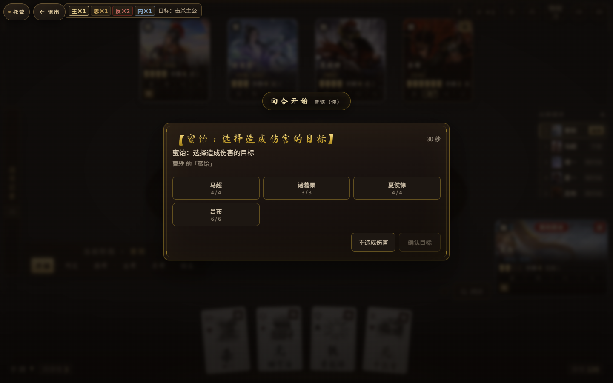

# 三国杀：五人军争（sanguosha）

> 浏览器里就能玩的《三国杀》身份局：React 19 + TypeScript + Vite 单页应用，
> 内置 AI 对手，99 名武将、完整回合阶段机与技能注册表，无需后端、无需下载。



> 上图为 e2e 用例《曹轶「蜜饴」会向玩家弹出目标选择窗》实际跑出来的画面（1440×900）。
> 由 `e2e/helpers.ts` 的 `shot()` 生成，换成新截图时覆盖 `docs/images/screenshot-game.png` 即可。

---

## 在线地址

**https://chenbenkong.github.io/sanguosha/**

推送到 `main` 分支即自动构建并发布到 GitHub Pages，详见 [部署](#部署)。

## 本地运行

前置要求：**Node.js ≥ 22**（`.nvmrc` 与 `package.json` 的 `engines` 均要求 22；CI 使用 22）。

```bash
npm install          # 安装依赖
npm run dev          # 开发服务器，默认 http://localhost:3000（已开放 0.0.0.0）
npm run build        # 生产构建，产物在 dist/
npm run preview      # 本地预览 dist/ 产物
```

纯前端项目：没有服务端、没有环境变量、没有数据库。

## 技术栈

| 类别 | 选型 |
| --- | --- |
| 框架 | React 19（无路由，单页） |
| 语言 | TypeScript 5.8（`strict`，构建前必须 `tsc --noEmit` 通过） |
| 构建 | Vite 6 + `@vitejs/plugin-react`，按模块手工分包 |
| 样式 | Tailwind CSS 3.4（构建期编译）+ CSS 变量主题（明 / 暗） |
| 测试 | Vitest 5（单测 / e2e）+ `node:test`（规则用例） |
| 部署 | GitHub Actions → GitHub Pages |

## 目录结构

```
sanguosha/
├── App.tsx                    # 应用外壳 + 对局主循环（回合机、AI 调度、结算）
├── constants.ts               # HEROES 武将表、牌堆生成、音效配置
├── types.ts                   # Card / Hero / Player / Identity / GamePhase
├── index.tsx                  # React 入口
├── src/
│   ├── game/
│   │   ├── combat.ts          # 战斗结算引擎（出牌、伤害、濒死、判定）
│   │   ├── rules.ts utils.ts  # 纯规则函数（无 React 依赖，便于单测）
│   │   ├── skills/            # ★ 技能注册表，见下节
│   │   ├── ai/                # AI 选目标、关系推理、技能决策闸门
│   │   ├── policies/          # 武将 / 装备的决策策略
│   │   ├── save.ts            # 对局存档（localStorage）
│   │   └── constants.ts gameStore.ts gameApi.ts
│   ├── components/game/       # 对局界面组件（手牌、座位、弹窗…）
│   ├── components/            # 通用组件（首页、结算、图标、教学）
│   ├── audio/                 # WebAudio 合成音效 + 语音调度
│   ├── screens/ contexts/ hooks/ config/
│   └── styles/theme.css       # 主题变量、弹窗体系、座位布局
├── public/                    # 头像、卡面、背景、BGM、字体（随构建打包）
├── tests/                     # Vitest 单测（规则 / 存档 / 结构体检）
├── e2e/                       # 真实浏览器端到端用例
└── .github/workflows/deploy.yml
```

### `src/game/skills/` —— 技能注册表

这是本项目最重要的结构约定。**每个武将技能都是一个独立注册的模块，
引擎在对应时机统一分发，不需要在 `App.tsx` / `combat.ts` 里写 `hero.name === 'X'` 分支。**

| 文件 | 作用 |
| --- | --- |
| `registry.ts` | 定义 `SkillDef` / `SkillHooks` / `SkillContext`，提供 `registerSkill()` |
| `dispatch.ts` | 9 个 `dispatch*` 分发器，遍历注册表并按时机调用技能钩子；内含递归深度保护 |
| `index.ts` | 注册入口：只负责 `import` 各个 batch 文件 —— **新技能在这里加一行** |
| `batch6.ts` / `batch7.ts` / `batch8.ts` / `migrated1.ts` | 各批次的技能实现，共 52 处 `registerSkill()` |
| `testHarness.ts` | 不启动 React 的牌局夹具（造牌、造人、记录副作用） |
| `*.test.ts` | 行为测试 + 三个守卫测试（见「测试体系」） |

现状：`constants.ts` 的 `HEROES` 共声明 99 名武将，其中 **52 个技能已迁入注册表**，
其余仍以 `LEGACY_INLINE` 清单登记在 `skillCoverage.test.ts` 里，**该清单只允许缩小**。

## 如何添加一个新武将技能

以「某武将 · 技能名」为例，四步。

### 1. 在 `HEROES` 里声明武将与技能

编辑 `constants.ts` 的 `HEROES`（`skillName` 多个技能用 `/` 分隔）：

```ts
{
  id: 'xxx',
  name: '某武将',
  kingdom: '魏',
  maxHp: 3,
  avatarUrl: 'images/heroes/某武将.webp',
  description: '一句话人物简介',
  skillName: '技能名',
  skillDesc: '技能描述（图鉴与对局内的说明文案）',
  gender: 'female',
}
```

同时把立绘放到 `public/images/heroes/某武将.webp`（建议 320×320 起的 webp）。

### 2. 写技能实现：新建 `src/game/skills/<名字>.ts`

```ts
import { registerSkill } from './registry';
import type { SkillContext, DamageEvent } from './registry';

registerSkill({
  hero: '某武将',        // 必须与 HEROES 里的 name 完全一致
  skill: '技能名',       // 必须与 skillName 中的一项完全一致
  locked: true,          // 可选：锁定技（自动发动，不询问玩家）
  hooks: {
    // 只实现你需要的时机，全部可选
    afterDamage: (ctx: SkillContext, ev: DamageEvent) => {
      if (ev.victim.id !== ctx.self.id) return;   // 只关心自己受伤
      ctx.draw(ctx.self.id, 1);
      ctx.log('【技能名】' + ctx.self.hero.name + ' 受到伤害，摸一张牌');
      ctx.banner();                                // 播放技能横幅 + 音效
    },
  },
});
```

**9 个可用钩子**（都定义在 `registry.ts` 的 `SkillHooks` 里）：

| 钩子 | 触发时机 | 返回 |
| --- | --- | --- |
| `onTurnStart` | 某角色回合开始 | `void` / `Promise<void>` |
| `onTurnEnd` | 某角色回合结束 | 同上 |
| `drawPhaseBonus` | 摸牌阶段 | 额外摸牌数 `number` |
| `afterDamage` | 有人受到伤害后 | `void` |
| `afterDealDamage` | 有人造成伤害后 | `void` |
| `afterCardUsed` | 任意角色使用一张牌后 | `void` |
| `afterJudge` | 判定牌生效后 | `void` |
| `handLimitBonus` | 弃牌阶段前 | 手牌上限增量 `number` |
| `exemptHandCards` | 弃牌阶段前 | 不计入手牌上限的牌数 `number` |

**`SkillContext`（`ctx`）能做什么**：
`draw` / `discard` / `heal` / `damage` / `gainCard` 施加效果；
`log` 写战报，`banner()` 播技能演出，`delay` 控制节奏；
`requestChoice()` 向玩家提问（选目标 / 选牌 / 选选项，复用引擎的读秒弹窗，
**AI 与托管场景返回 `null`，技能必须据此走自动决策分支**）；
`memory` 是本技能跨回合的存储，`heroMemory` 是同武将多技能共享的存储。

### 3. 在 `src/game/skills/index.ts` 里注册

```ts
import './batch8';
import './某名字';   // ← 加这一行
```

不需要改 `App.tsx`、`combat.ts` 或任何接口。

### 4. 补测试，并从覆盖清单里删掉

1. 在 `src/game/skills/` 下新增或复用行为测试，用 `testHarness` 造牌局：

```ts
import { describe, expect, it } from 'vitest';
import { mkCard, mkPlayer, makeHarness, drawnFor } from './testHarness';
import { dispatchAfterDamage } from './dispatch';
import './index';

it('某武将「技能名」受伤后摸一张', async () => {
  const me = mkPlayer({ name: '某武将', id: 0 });
  const { deps, fx } = makeHarness([me, mkPlayer({ name: '甲', id: 1 })]);
  await dispatchAfterDamage(deps, {
    victim: me, source: undefined, amount: 1, nature: 'normal', card: mkCard(),
  });
  expect(drawnFor(fx, 0)).toBe(1);
});
```

2. 打开 `src/game/skills/skillCoverage.test.ts`，把 `LEGACY_INLINE` 里对应的
   `'某武将::技能名'` 这一行**删掉**。清单里残留已迁移条目会让第二个守卫用例直接失败。

3. 跑一遍完整校验（见 [CONTRIBUTING.md](CONTRIBUTING.md)），其中
   `npm run typecheck` 与 `npm run test:unit` 必须全绿。

## 测试体系

三套测试职责不同，互不替代，**三个都必须跑**。

| 命令 | 框架 | 规模 | 职责 |
| --- | --- | --- | --- |
| `npm run test:unit` | Vitest | 30 个文件 / **558 条** | 规则、技能行为、AI 策略、存档、静态结构体检 |
| `npm test` | `node:test`（原生） | 1 个文件 / **14 条** | `src/game/rules.test.ts` 核心规则用例，不经任何适配层 |
| `npm run test:e2e` | Vitest + puppeteer-core | **6 条** | 真实 Chrome 里跑一局：加载无报错、能选将开局、回合能推进、技能弹窗会出现 |

`npm test` 与 `npm run test:unit` 都能跑 `src/game/rules.test.ts`：Vitest 侧通过
`vitest.config.ts` 的别名把 `node:test` / `node:assert` 指向 `tests/shims/node-test.ts` 适配层，
被测源码零改动。

e2e 需要 **系统 Chrome**（用 `puppeteer-core` 而不是完整 puppeteer，避免下载 150MB Chromium）：

```bash
# 默认路径：Windows C:\Program Files\Google\Chrome\Application\chrome.exe
#            macOS /Applications/Google Chrome.app/Contents/MacOS/Google Chrome
#            Linux  /usr/bin/google-chrome
# 自定义路径：
E2E_CHROME="/path/to/chrome" npm run test:e2e
```

e2e 会自己起 `vite preview`（端口 7300），所以**必须先有 `dist/` 产物**：跑过 `npm run build` 再跑 e2e。

### 三个「防 bug 守卫」

这三个测试不测规则，测的是**声明与实现有没有脱节** —— 它们各自对应一类真实发生过的线上事故：

| 守卫 | 文件 | 防的是什么 |
| --- | --- | --- |
| 技能覆盖守卫 | `skillCoverage.test.ts` | 技能在 `HEROES` 里声明了、图鉴也展示了，但引擎里没实现，玩家点了没反应 |
| 引擎接线守卫 | `wiring.test.ts` | `dispatch.ts` 的分发函数写了却从没被 `App.tsx`/`combat.ts` 调用（曾导致 22 个技能永不触发） |
| 钩子分发守卫 | `hookCoverage.test.ts` | `SkillHooks` 声明了某个钩子、也有技能实现它，但 `dispatch.ts` 没有对应分发器 |

**不要为了让它变绿去删除或放宽它们**，那等于删掉事后唯一的报警器。正确做法是补上缺失的实现或接线。

## 部署

`.github/workflows/deploy.yml` 在 `push` 到 `main`（或手动 `workflow_dispatch`）时执行，
按顺序四道闸门，任一失败即阻断发布：

1. `npx tsc --noEmit` —— 类型检查
2. `npm run test:unit` + `npm test` —— 单测与规则用例
3. `npx vite build --base=./` —— 生产构建（`--base=./` 以适配 Pages 子路径）
4. `npm run test:e2e` —— 找到系统 Chrome 才跑，找不到则跳过（不阻断）

构建后打印 `dist` 体积摘要，再经 `actions/configure-pages` + `upload-pages-artifact` 发布到 GitHub Pages。
本地想复现 Pages 环境，用 `npm run build`（等价于 `npx vite build --base=./`）+ `npm run preview`。

## 常见问题

**`npm run build` / CI 报类型错误？**
先单独跑 `npm run typecheck` 定位；类型检查是部署第一道闸门，不会跳过。

**e2e 全红 / 报找不到浏览器？**
确认装了系统 Chrome，或用 `E2E_CHROME` 指定路径；再确认已 `npm run build`（e2e 依赖 `dist/`）。
端口 7300 被占用时 e2e 起不来，先释放端口。

**`npm test` 通过但 `npm run test:unit` 失败？**
两者跑的是不同集合。`test:unit` 覆盖 `tests/**` 与 `src/**` 全部用例，
失败通常来自守卫测试（技能覆盖 / 接线 / 钩子分发），按报错补实现或补注册即可。

**新增技能后守卫报「未登记」？**
要么在 `skills/index.ts` 里 import 了却忘了 `registerSkill`，
要么 `skillName` 与 `registerSkill` 的 `skill` 字符串不一致（差一个空格也算）。

**开发时页面栈溢出 / AI 回合卡住？**
检查是否把内部结算函数命名成了 `useXxx`。React Fast Refresh 会把 `use` 前缀当 Hook 推导组件签名，
内部函数请用 `resolveXxx` 之类命名。

**运行 Node 版本不对？**
`node -v` 必须 ≥ 22（`node:test` 与 `--experimental-transform-types` 需要）。
用 `nvm use` 会读仓库根的 `.nvmrc`。

## 最近更新

当前版本号：`APP_VERSION`（`src/game/constants.ts`）。以下为最后的 3 条成文更新记录。

**v3.56** 武将阵亡语音换成**官方真人原声**（93 名，含全部新女将），取代原先 45 名的
TTS 合成；素材说明见 [public/audio/die-voice/素材说明.md](public/audio/die-voice/素材说明.md)。
**v3.55** 选将页新增「卡面」模式：97 名武将可切换为三国杀官方完整卡面（含势力、勾玉与技能文本），
大图查看与武将详情同步支持；两名无卡面武将自动回落立绘。

**v3.31** 新增 7 名女将（关银屏 / 张星彩 / 卞夫人 / 诸葛果 / 曹节 / 伏皇后 / 马云禄），
立绘统一升级，语音走白名单回退。

**v3.30** 修复开发环境栈溢出导致的 AI 回合卡死，首页与选将页重排，对局界面统一墨底金边。

**v3.29** 修复 AI 同一阶段重复推进，1 倍速放慢 AI 节奏，新增武将详情面板。

完整历史（v2.0 起逐版记录）见 **[CHANGELOG.md](CHANGELOG.md)**。

## 许可与素材

非商业个人练习项目。素材来源分别见
[public/images/heroes/素材说明.md](public/images/heroes/素材说明.md)（竖幅立绘）、
[public/images/fullcards/素材说明.md](public/images/fullcards/素材说明.md)（官方完整卡面）与
[public/audio/语音说明.md](public/audio/语音说明.md)。
贡献约定见 [CONTRIBUTING.md](CONTRIBUTING.md)。
